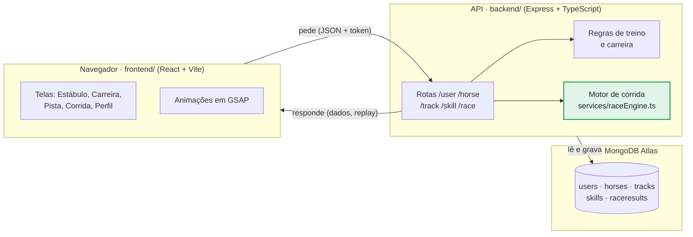
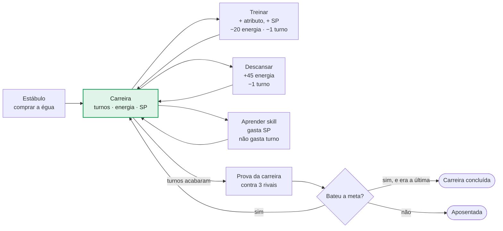
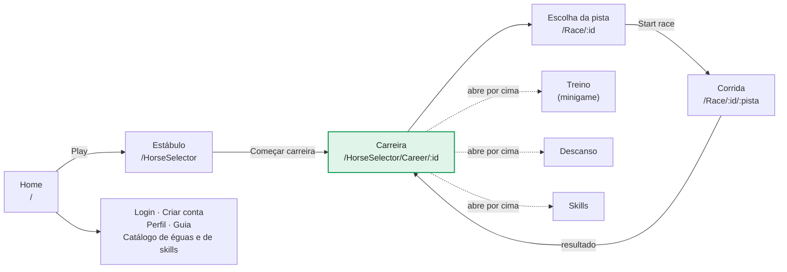
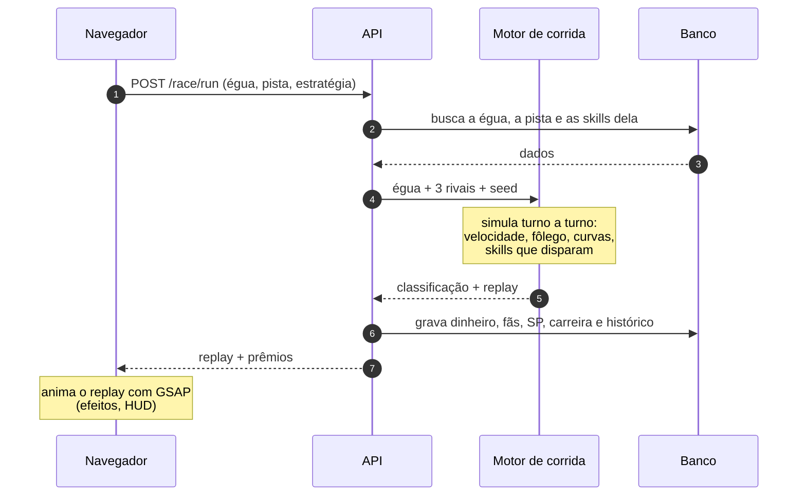
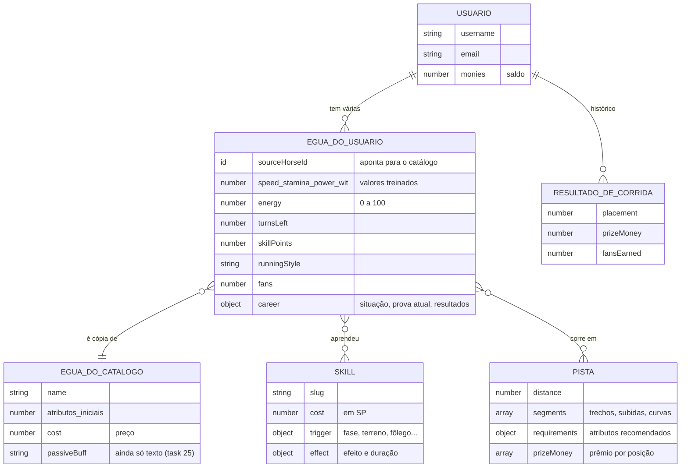

# UmaSprint — Visão geral em diagramas

Como o jogo funciona por dentro, em cinco desenhos: quem conversa com quem, o ciclo de uma
carreira, o caminho entre as telas, o que acontece numa corrida e onde cada dado mora.
Os diagramas são [Mermaid](https://mermaid.js.org/): o GitHub e o VS Code desenham sozinhos.

Para as regras e fórmulas completas, veja o [design do sistema de corrida](race-system-design.md);
para jogar, o [guia do jogador](guia-do-jogador.md).

- [1. Arquitetura](#1-arquitetura)
- [2. Ciclo da carreira](#2-ciclo-da-carreira)
- [3. Telas](#3-telas)
- [4. Uma corrida por dentro](#4-uma-corrida-por-dentro)
- [5. Dados](#5-dados)
- [Os atributos na corrida](#os-atributos-na-corrida)
- [Onde está cada coisa](#onde-está-cada-coisa)

---

## 1. Arquitetura

Três peças. O navegador só mostra e anima. Toda regra que mexe no save (treino, descanso,
compra, corrida) roda na API, e só a API fala com o banco. Assim ninguém consegue forjar um
resultado pelo navegador.

As chamadas levam o token de login no cabeçalho `Authorization`. Em verde, o motor de
corrida: ele roda só no servidor.

---

## 2. Ciclo da carreira

Cada égua tem um calendário de provas. Antes de cada prova ela tem alguns turnos para
treinar, descansar e aprender skills. Na prova da carreira ela precisa chegar até uma
colocação mínima, a **meta** (por exemplo, terminar entre as 3 primeiras). Se bater a meta,
recebe a próxima prova e novos turnos; se não bater, a carreira acaba.

- A energia vai de 0 a 100; treinar com pouca energia arrisca um ganho menor.
- Bater a meta devolve os turnos da prova seguinte.
- Concluída ou aposentada, dá para começar uma nova carreira com a mesma égua. A antiga
  fica guardada como registro e aparece no perfil.
- As rivais são montadas a partir dos atributos dela (0,9 a 1,3 vezes), então as provas
  são difíceis de propósito.

---

## 3. Telas

O caminho principal vai da Home até a corrida, e a corrida volta para a carreira. Treino,
descanso e skills abrem **por cima** da tela de carreira, sem trocar de página.

As rotas ficam em `frontend/src/routes/AppRoutes.tsx`. Trocar de página passa por uma
cortina na cor da égua (`PageTransition`).

---

## 4. Uma corrida por dentro

O servidor corre e o navegador assiste. O navegador manda só a égua, a pista e a
estratégia; o servidor monta o pelotão, simula a prova turno a turno e devolve um replay
pronto, que a tela de corrida apenas anima.

A **seed** é um número que fixa a sorte da corrida: a mesma seed com as mesmas corredoras dá
sempre o mesmo resultado. O replay traz 4 posições por turno de cada corredora, e a tela
interpola entre elas.

---

## 5. Dados

O ponto que mais confunde: o **catálogo** guarda a égua "de fábrica", e o que você treina é
uma **cópia** dela, salva dentro do seu usuário. Uma égua pode ter várias cópias (cada
carreira antiga fica como registro), mas só uma em andamento.

No banco, as éguas do usuário ficam dentro do próprio documento dele (`users.horses`); as
outras caixas são coleções separadas (`horses`, `skills`, `tracks`, `raceresults`).

---

## Os atributos na corrida

A velocidade é medida em metros por turno, e os atributos entram direto nas contas:
Speed 120 quer dizer até 120 metros por turno.

| Atributo | O que faz | Na conta |
|---|---|---|
| **Speed** | O teto: a velocidade máxima que ela alcança. | `v ≤ Speed` |
| **Power** | A arrancada e quanto ela acelera por turno até o teto. | largada = `Power ÷ 2` |
| **Stamina** | O tanque de fôlego. Se zerar, ela fica cansada até o fim e o teto cai pela metade. | fôlego inicial = `Stamina` |
| **Wit** | Gasta menos fôlego e aumenta a chance de as skills dispararem. | chance + `Wit × 0,002` |

---

## Onde está cada coisa

| Arquivo | O que tem |
|---|---|
| `backend/src/services/raceEngine.ts` | O motor de corrida por turnos. |
| `backend/src/services/rivalGenerator.ts` | Monta as 3 rivais a partir da égua do jogador. |
| `backend/src/services/trainingEngine.ts` | Ganho do treino, custo de energia e descanso. |
| `backend/src/services/career.ts` | Calendário de provas, metas e aposentadoria. |
| `backend/src/controllers/` | O que cada rota faz (usuário, corrida, skills, pistas). |
| `frontend/src/routes/AppRoutes.tsx` | A lista de telas e seus endereços. |
| `frontend/src/components/` | As telas: `Stable`, `CareerMenu`, `RaceTrackSelect`, `RaceRunner`… |
| `frontend/src/animations/` | Os hooks de animação em GSAP usados pelas telas v2. |
| `docs/race-system-design.md` | As fórmulas completas da corrida, do treino e das skills. |
| `docs/tasks/` | Uma ficha por tarefa, com o histórico do que foi feito. |
